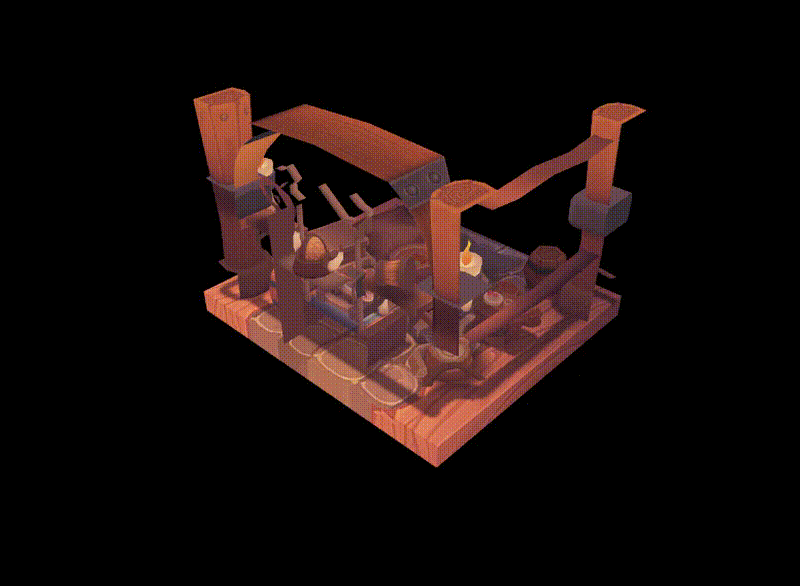

# 3D Vulkan App

This creates a window with a moving, rendered 3D scene. A small 3D rendering project built in C++ with the Vulkan API.

This project was created while working through [Vulkan Tutorial](https://vulkan-tutorial.com/) to learn how a modern low-level graphics API works. Most of the Vulkan implementation closely follows the tutorial, with some additional experimentation around input, timing, audio, and application structure.

## Running the Project

The project requires a Vulkan-capable GPU and the required development libraries.

Build instructions may vary depending on the platform and installed Vulkan environment.

Setting up the development environment is based on [The Vulkan Tutorial](https://vulkan-tutorial.com/Development_environment) website.

Main dependencies include:
- Vulkan SDK / Vulkan development packages
- GLFW
- GLM
- stb_image
- tinyobjloader

1. The Vulkan SDK is needed to run this program, which can be downloaded from [the LunarG website](https://vulkan.lunarg.com/). Once installed, you can go to the *bin/* directory and run *vkcube.exe* to test that the SDK works.
2. GLFW can be installed by clicking the download link for [their website](https://www.glfw.org/). Make sure to at least use version 3.3.
3. GLM can be installed by following the [GLM github page](https://github.com/g-truc/glm) and following the instructions at "Build and Install".
4. Finally, run make to build the bin that runs the program.

## Usage

This program is mostly non-interactible, and serves as an example of a running application capable of rendering 3D objects with textures, mipmaps, anti-aliasing, running sound, inputs, and movement.
The 3D scene and textures can be found in the models and textures directories.
Most of the logic can be found in engine.cpp, with the imports being in c_types.h.
All of the inputs, and the window behavior is handled by GLFW.
The audio is handled by FMOD in audio.cpp, and can be altered by pressing a button.

## Features

- Vulkan instance and device setup
- Swapchain creation and recreation
- Graphics pipeline setup
- Vertex and index buffers
- OBJ model loading
- Textures and samplers
- Mipmap generation
- Depth buffering
- Multisample anti-aliasing (MSAA)
- Uniform buffers
- Descriptor sets
- Command buffers
- Semaphores and fences for synchronization
- Basic keyboard input
- Delta-time based updates

## What I Learned

The main goal of this project was to understand what happens underneath higher-level graphics engines.

Working directly with Vulkan helped me get a better understanding of:

- how rendering commands are recorded and submitted to the GPU;
- how resources such as buffers, images, and textures are managed;
- how the graphics pipeline is configured;
- how swapchains and framebuffers are used to present images;
- how synchronization between the CPU and GPU works;
- how depth buffering, mipmapping, and MSAA fit into the rendering process.

One of the most useful parts of the project was seeing how much work a low-level API exposes compared with engines such as Godot or Unity.

## Credits

The Vulkan implementation is primarily based on the excellent
[Vulkan Tutorial](https://vulkan-tutorial.com/).

The project uses the Viking Room model and texture from the Vulkan Tutorial resources.

## Future Work

This repository is mainly kept as a record of my first larger Vulkan project.

I plan to continue exploring graphics programming in a separate Vulkan game-engine project, where I can focus more on engine architecture, rendering systems, tooling, profiling, and performance.
